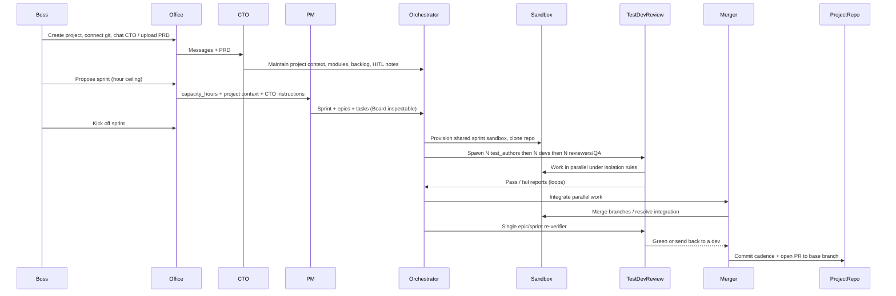
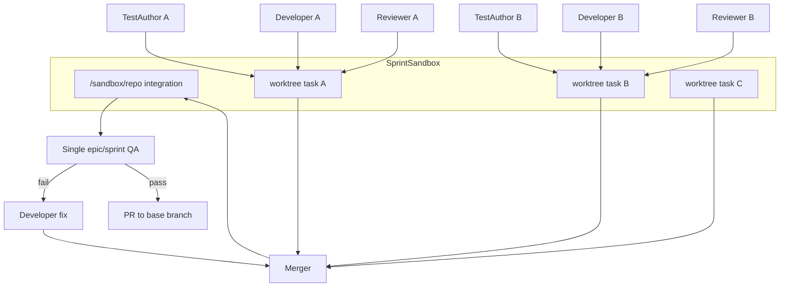

# Buildshift Orchestration Revamp

**Status:** draft for review / lock  
**Date:** 2026-10-24  
**Owner:** Mamoor  
**Scope:** Rebuild the orchestration layer for real, production-usable agent work from day one. Keep the existing Office UI; enhance it later. Discard mock-first pipeline, per-task throwaway workers, and stub paths.

---

## 1. Why

Today we have a working **control plane + mock-proven pipeline + operator office**, not a trustworthy production engine. The old design (one container/worktree per task, mock harness as the happy path, thin prompt → coding CLI) will not become that engine by incremental fixes.

We rebuild orchestration so that:

- Boss steers via **CTO** and **PM**, then real multi-agent execution runs in a **shared per-sprint sandbox**.
- Every agent is a **proper autonomous harness** (tools, web search, actions) — not a single LLM call wrapper.
- Providers and models are **fully swappable**, including **local LLMs**.
- Confinement is hard: sandbox + configured project git repo only.
- We test with **real** repos, tools, and models from the first vertical slice — **no mocks / stubs**.

---

## 2. Locked decisions

| # | Decision | Lock |
|---|----------|------|
| 1 | Sandbox lifetime | **One sandbox per sprint** (created at kickoff; torn down or archived when sprint completes / is abandoned) |
| 2 | Parallelism in one sandbox | Must be solved properly (see §6) — no “hope they don’t collide” |
| 3 | Agent substrate | Maximize flexibility from day one (see §7) |
| 4 | Merger | **Proper LLM agent** with git tools, scoped to the configured project repo only |
| 5 | First delivery | Vertical slice: CTO → PM propose → kickoff → sandbox → one (then N) task path through test → dev → review → merger → PR, on a **real** small repo |
| 6 | Review / QA cardinality | **N parallel** for per-task review/QA (sized by work coming from devs). **Exactly one** agent for **epic-level** or **sprint-level** re-verify |
| 7 | Office UI | **Keep as-is** for now; wire to new orchestrator contracts as they stabilize; enhance later — do not rebuild Phaser/HUD from scratch |
| 8 | Mocks | **No** mock harness, no stub “fake merge” paths in the new loop |

---

## 3. Target product flow (Boss view)



### 3.1 Roles

| Role | Cardinality | Who talks to them | Responsibility |
|------|-------------|-------------------|----------------|
| **CTO** | 1 per project | **Boss only** (Office CTO chat / PRD upload) | Primary mind. Create/update/maintain **project context** used by all later agents. Index PRD, backlog notes, priorities, HITL questions. Does **not** spawn workers or kick off sprints. |
| **PM** | 1 per propose | Boss via Plan → Propose | Reads project context + CTO instructions + hour **ceiling**. Produces sprint → epics → detailed tasks sized for **AI agent hours** (not human hours). Prefer open backlog. |
| **Test author** | **N** (by tasks) | Orchestrator | Writes / updates tests from acceptance criteria **before** implementers for those tasks. |
| **Developer** | **N** (by tasks) | Orchestrator | Implements against tests and AC, in parallel, independently. |
| **Reviewer / QA** | **N** for task-level; **1** for epic/sprint re-verify | Orchestrator | Task-level: independent review/QA; fail → report back to owning developer until green. Epic/sprint-level: **single** agent re-verifies the integrated picture. |
| **Merger** | 1 per integration wave | Orchestrator | LLM agent with git tools. Integrates parallel developer work; may commit at **epic end** or **sprint end**; opens PR to project base branch; never touches other repos. |

### 3.2 Stage machine (sprint execution)

High-level phases after kickoff:

1. **Sandbox provision** — create sprint sandbox, clone configured repo, baseline env.
2. **Test-authoring wave** — spawn N test authors for ready tasks (deps satisfied, paths free).
3. **Development wave** — spawn N developers for tasks whose tests are ready.
4. **Task-level review/QA wave** — N reviewers/QA; fail loops back to the specific developer with a structured report.
5. **Integration (Merger)** — merge parallel work into a coherent tree on the sandbox.
6. **Epic- or sprint-level re-verify** — **one** reviewer/QA agent on the integrated result.
7. If fail → assign a developer (or small set) to fix → Merger again → re-verify again.
8. **Land** — Merger commits (per policy) and opens PR to base branch.

Pause / resume / kill switch remain first-class (orchestrator refuses new agent starts when kill is on or sprint is pausing).

---

## 4. Tenancy and data model

Everything is **project-tenanted**.

### 4.1 Keep (conceptual contracts the Office already uses)

Preserve these *ideas* and prefer stable HTTP shapes so [`apps/dashboard`](apps/dashboard) needs only thin adapter changes:

- `Project` (title, slug, PRD, `context_markdown`, index status, repo_url / repo_path / repo_branch)
- CTO chat messages + actions that update context / backlog / HITL
- `Sprint` (capacity_hours ceiling, status: draft → active → …)
- `Epic` / `Task` hierarchy for Board
- HITL inbox, events/SSE, Control settings, EOD/usage digests (can lag the first vertical slice)
- Operator auth via `OPERATOR_TOKEN`

Concrete Office client: [`apps/dashboard/src/lib/api.ts`](apps/dashboard/src/lib/api.ts).

### 4.2 Replace / add

| Concept | Purpose |
|---------|---------|
| **SprintSandbox** | Lifecycle record: container/id, host paths, clone status, env fingerprint, created_at, destroyed_at |
| **AgentSession** | One running (or finished) agent instance: role, task_id or epic_id or sprint_id scope, model, status, branch/worktree, spend, logs |
| **HandoffReport** | Structured pass/fail from reviewer/QA → developer (or merger → re-verifier) |
| **IntegrationWave** | Merger run tying a set of task branches → integrated ref + optional commit SHA |
| **ProviderProfile** | Named LLM endpoint config (cloud or local) referenced by role map |

### 4.3 Discard from the *new* execution path

Do not port forward as the real path:

- Mock harness and “fake green” fixture commits as production loop
- One disposable Docker run **per task** as the only isolation model ([`services/worker`](services/worker) entrypoint-as-entire-world)
- Legacy single-container multi-role stage loop that assumes per-task worktree = whole world ([`apps/orchestrator/.../runner/pipeline.py`](apps/orchestrator/src/buildshift_orchestrator/runner/pipeline.py))
- Heuristic / regex PRD scrapers (CTO LLM remains the indexer)
- Proving-repo-only global fallback as the primary story (per-project repo is required for real kickoff)

Old code may remain briefly behind a feature flag or deleted in chunks during implementation — preference: **delete junk as new path replaces it**, not maintain two permanent engines.

---

## 5. Sprint sandbox

### 5.1 Lifecycle

```
kickoff_sprint
  → create SprintSandbox record
  → start long-lived sandbox environment (Docker container on the Compose host)
  → clone project repo into sandbox workspace (base branch)
  → install baseline tooling if needed (git, common CLIs); role-specific installs happen on demand by agents
  → mark sandbox ready
  → scheduler may spawn agents

sprint complete / abandon / wipe
  → stop agents
  → archive logs + final git state metadata
  → destroy sandbox (or retain volume for debug under an explicit flag)
```

**Unit:** one sandbox **per sprint** (locked). A new sprint → new sandbox (clean clone from current base tip unless we later add “warm cache” as an optimization).

### 5.2 What “shared environment” means

- **One** filesystem + OS userland for the sprint: Node/Python/Playwright installs done once are visible to later agents.
- Agents are **not** each getting a full separate machine image for isolation of packages.
- Agents **are** isolated from each other for **source edits** via the parallelism scheme in §6.
- Sandbox is isolated from the **host**: no Docker socket for agents, no home directory mounts of the operator, no access to other projects’ mirrors.

### 5.3 Layout (inside sandbox)

```
/sandbox/
  repo/                 # primary clone (merger’s integration checkout)
  worktrees/            # per-agent or per-task git worktrees (see §6)
  artifacts/            # reports, screenshots, logs
  .buildshift/          # prompts, session manifests, policy files
```

Host-side mirror of metadata stays under `data/sprints/{sprint_id}/` (logs, event copies). The live working tree lives in the sandbox volume.

### 5.4 Confinement

| Boundary | Rule |
|----------|------|
| Filesystem | Bind only sprint volume + read-only policy/config; never host `$HOME`, never other projects |
| Network | Egress allowlist (LLM gateway, docs, package registries as needed); no arbitrary lateral access |
| Git credentials | Token injected only via a **repo-scoped proxy** (pattern already sketched in [`services/worker/github_proxy.py`](services/worker/github_proxy.py)); agents never see a PAT; allowlist **one** `owner/repo` |
| Git remotes | Only the configured project remote; deny `git clone`/`fetch`/`push` to other remotes via wrapper / permissions |
| Privileges | Non-root where possible; `no-new-privileges`; no host Docker socket inside sandbox |

---

## 6. Parallelism in a shared sandbox (critical)

**Problem:** N developers (and N test authors / reviewers) must work independently in parallel without corrupting each other’s edits, while sharing the same installed toolchain.

**Solution (locked for v1):** **Git worktree + branch per task (or per agent session), path ownership enforced by the orchestrator, Merger integrates.**

### 6.1 Rules

1. **PM / orchestrator assigns `owned_paths[]` per task** (as today). Overlapping owned paths across *concurrent* tasks are rejected at propose/kickoff validation (or serialized by dependency).
2. Each task gets:
   - branch `buildshift/{sprint_slug}/{task_short_id}`
   - git **worktree** under `/sandbox/worktrees/{task_id}` linked to the sandbox repo
3. Test author, developer, and task-level reviewer for that task **reuse the same worktree/branch** (sequential roles on one task; parallel across tasks).
4. Orchestrator **path locks** still apply as a safety net (task cannot start if another active session holds overlapping paths).
5. Agents may only write under their worktree; policy denies editing `/sandbox/repo` directly except **Merger**.
6. **Merger** agent:
   - works in `/sandbox/repo` (integration checkout on an integration branch, e.g. `buildshift/{sprint_slug}/integrate`)
   - merges task branches in dependency order
   - runs/requests epic/sprint re-verify on the integrated tree
   - commits per cadence (§8) and opens PR to `repo_branch`

### 6.2 Why this design

- Shared **packages and tools** (one Node install, one Playwright browser download) without shared **dirty working trees**.
- Natural unit of integration for the Merger agent.
- Failure isolation: a bad task branch does not leave half-edited files in another task’s tree.
- Matches “everyone on the same system, independently and in parallel.”

### 6.3 Conflict handling

- If merge conflicts: Merger agent resolves within policy (or opens HITL if ambiguous product conflict).
- If two tasks were wrongly given overlapping paths: kickoff validator / PM prompt constraints should prevent; runtime path lock is backup.



---

## 7. Agent harness and LLM abstraction

### 7.1 Principle

Each role is a **session of an autonomous coding agent** with tools (shell, editor, web search/fetch, git via wrappers), not `chat.completions` once and exit.

### 7.2 Flexibility from day one (locked approach)

Introduce a thin **Agent Runtime Adapter** interface owned by the orchestrator (and used inside the sandbox supervisor):

```text
AgentRuntime
  start_session(role, model_ref, workspace, policy, prompt) -> session_id
  wait / stream events
  stop / cancel
```

**v1 concrete backend:** **OpenCode headless** (already in-tree direction) talking to an **OpenAI-compatible** base URL. That keeps one harness while models come from:

- LiteLLM → Vercel / OpenAI / Anthropic / etc.
- LiteLLM → **local** OpenAI-compatible servers (Ollama, LM Studio, vLLM, …)
- Direct OpenAI-compatible URL in Control (bypass LiteLLM when desired)

Optional second backend later: Claude Code via `ANTHROPIC_BASE_URL` — same `AgentRuntime` interface; **not** required for slice 1 if OpenCode + local/cloud OpenAI-compat covers flexibility.

### 7.3 Control plane: role → model → provider

Extend Control / `runtime_settings` (Office Control panel stays the day-to-day UI):

```yaml
providers:
  litellm_cloud:
    kind: openai_compatible
    base_url: http://litellm:4000/v1
    api_key_env: LITELLM_MASTER_KEY
  local_ollama:
    kind: openai_compatible
    base_url: http://host.docker.internal:11434/v1
    api_key_env: null

roles:
  cto:      { provider: litellm_cloud, model: ... }
  pm:       { provider: litellm_cloud, model: ... }
  test_author: { provider: local_ollama, model: ... }
  developer:   { provider: litellm_cloud, model: ... }
  reviewer:    { provider: litellm_cloud, model: ... }
  merger:      { provider: litellm_cloud, model: ... }
```

Secrets stay in `.env`; provider **routing** lives in Control. Changing a role’s model/provider must not require rebuilding images.

### 7.4 Tool policy (all agents)

Allow (inside sandbox):

- Read/write within assigned worktree (or `/sandbox/repo` for Merger)
- Package installs in sandbox
- Tests, linters, Playwright, etc.
- Web search / docs fetch via allowlisted egress
- Git: status, diff, commit, checkout **within** assigned branch/worktree; push only through Merger + proxy allowlist

Deny:

- Leaving `/sandbox`
- Docker socket / host mounts
- Reading other sprint volumes
- Using credentials except through the repo-scoped proxy
- Force-push to base; push to non-allowlisted remotes

---

## 8. Merger agent and commit cadence

- Merger is an **LLM agent** with git tools + orchestrator-provided integration brief (list of task branches, deps, AC summary).
- **Default cadence:** if the sprint has **multiple epics**, prefer **commit (and optional PR update) at end of each epic** after that epic’s integration + **single** epic-level re-verify passes. If one epic, commit at sprint end (same machinery).
- Merger may choose to batch further when safe; must not land failing re-verify.
- Final PR: against project `repo_branch`. `merged` in Buildshift means “integrated and PR opened / updated on base” per Control policy; human still merges to protected `main` if that is the host rule.

---

## 9. Review / QA cardinality (locked)

| Phase | Agents |
|-------|--------|
| After developers finish task work | **N** parallel reviewer/QA sessions (roughly one per completed task / batch as scheduled) |
| After Merger integrates an epic | **Exactly one** re-verifier |
| After Merger integrates the full sprint | **Exactly one** re-verifier |

Fail at task level → report to that task’s developer.  
Fail at epic/sprint re-verify → orchestrator assigns fix work (developer session on a fix branch/worktree) → Merger → one re-verifier again.

---

## 10. What we keep vs rewrite (code map)

| Area | Action |
|------|--------|
| [`apps/dashboard`](apps/dashboard) | **Keep**; later wire new events/states; no Phaser rebuild |
| [`apps/orchestrator`](apps/orchestrator) API surface for projects/sprints/CTO/HITL/control | **Keep shapes where possible**; reimplement handlers against new engine |
| Planning CTO/PM LLM flows | **Rebuild** on Agent Runtime (CTO/PM may stay “chat+tools” sessions without full sandbox, or run in a lightweight project context workspace — see §11) |
| [`runner/pipeline.py`](apps/orchestrator/src/buildshift_orchestrator/runner/pipeline.py), per-task `docker run` | **Replace** with SprintSandbox supervisor + agent sessions |
| [`services/worker`](services/worker) | **Replace** with sandbox image + agent supervisor (no mock mode) |
| [`services/litellm`](services/litellm) | **Keep** as default gateway; add local provider profiles |
| [`fixtures/demo-app`](fixtures/demo-app) | Keep only as a **real** tiny proving repo for the vertical slice — exercised with **real** agents, not mock writers |
| Smoke scripts that assert mock | **Replace** with real-slice smoke (requires keys / local model) |

---

## 11. CTO / PM execution placement

- **CTO & PM** do not need the full sprint sandbox (sandbox starts at kickoff).
- They run as orchestrator-side agent sessions with:
  - access to project PRD + `context_markdown` + backlog DB tools (structured actions), and
  - optional read-only clone of the project repo for grounding (future), and
  - **no** write access to product git until a sprint sandbox exists.
- Outputs: updated context, backlog items, HITL questions, sprint proposal JSON persisted by orchestrator (PM), same as today’s Board expectations.

---

## 12. Office visualization (later enhancement)

Office floor already shows roles/desks. As the new engine emits events:

- Spawn/despawn desk activity for N developers / N reviewers
- Show sandbox ready / agent session state
- Merger and single re-verifier as distinct stations
- Board already shows epic/task tree — keep as source of truth for inspect-before-kickoff

**Out of scope for slice 1:** major HUD redesign. Emit compatible SSE/`office/activity` as early as practical so the floor does not go dead.

---

## 13. Implementation phases

### Phase 0 — Repo hygiene and contracts (short)

- Land this doc; freeze decisions above.
- Inventory Office API usage; list breaking changes (minimize).
- Delete or quarantine mock harness from the **default** path (no `HARNESS=mock` success story).
- Define new tables / migrations sketch: `sprint_sandboxes`, `agent_sessions`, `handoff_reports`, provider profiles in `runtime_settings`.

### Phase 1 — Provider + Agent Runtime spine

- Implement `AgentRuntime` adapter (OpenCode + OpenAI-compatible providers).
- Control: provider profiles + role map (cloud + local example).
- Prove: CTO chat and PM propose against **real** models (no mock JSON fixtures).
- Project create, PRD → CTO context, Propose → Board inspectable — end-to-end with real LLM.

### Phase 2 — Sprint sandbox + single-task real loop

- On kickoff: provision sandbox, clone project repo, confinement + git proxy.
- One task: test_author → developer → reviewer (real agents in worktree).
- Merger: integrate (trivial for one branch) → **one** re-verifier → open PR.
- Path locks + worktree layout proven even for N=1.

**Exit criteria:** Boss can create a project on a real repo, chat CTO, propose a 1h sprint, kick off, and get a real PR without any mock code path.

### Phase 3 — Parallel N + fail loops

- Scheduler spawns N test authors / N developers / N reviewers by ready work.
- Owned-path validation; worktrees in parallel.
- Reviewer fail → `HandoffReport` → developer resume → until green.
- Budget + kill switch refuse new sessions.

### Phase 4 — Merger waves + epic/sprint re-verify

- Multi-epic sprint: integrate per epic; **one** re-verifier each time; commit cadence.
- Final sprint re-verify; PR update.
- HITL when Merger or re-verifier needs Boss.

### Phase 5 — Office wiring and hardening

- SSE / office activity for new session types.
- Egress allowlist hardening, stuck-session recovery, sandbox teardown, spend tracking accuracy.
- Docs: replace mock-centric README/RUNBOOK sections with real-slice operator flow.
- Remove dead mock/legacy pipeline code.

---

## 14. Vertical slice (Phase 2) — concrete checklist

1. Project with connected git repo (small real app; demo-app allowed only if run with **real** agents).
2. Boss ↔ CTO: PRD + context maintained in DB.
3. Propose sprint with hour ceiling → Board shows epics/tasks.
4. Kickoff → sandbox up → clone.
5. Single task pipeline with real OpenCode (or chosen runtime) sessions.
6. Merger opens PR to base branch.
7. Control can switch implementer model between cloud alias and local OpenAI-compatible endpoint without code change.
8. Kill switch stops further agent starts.

---

## 15. Non-goals (for this revamp track)

- Rebuilding the Phaser office from scratch
- Multi-tenant SaaS / multi-Boss auth
- Selling Buildshift as a hosted product
- Perfect vision-UI review matrix on day one (can follow once Merger loop is solid)
- Keeping the old per-task mock pipeline as a supported mode

---

## 16. Success metrics (early)

- Time from kickoff to first real PR on a toy repo (target: reliable, repeatable)
- Zero host-filesystem escapes in adversarial smoke
- Zero pushes to non-allowlisted repos
- Cost per merged PR tracked (real tokens only)
- Parked / HITL rate and re-verify fail loops visible in events

---

## 17. Open items to resolve during Phase 0–1 (non-blocking for locking this doc)

These do not reopen §2; they are implementation details to decide while coding:

- Exact sandbox base image (Debian + mise/asdf vs prebaked language images)
- Whether CTO/PM use the same OpenCode runtime or a lighter tool-calling loop for structured DB actions
- PR open vs PR+auto-merge policy when GitHub allows (default: open PR, human merges protected base)
- Retention period for destroyed sprint volumes

---

## 18. Review checklist (sign-off)

- [ ] Sandbox per sprint
- [ ] Worktree + branch per task; Merger-only integration checkout
- [ ] N parallel task-level QA/review; **one** epic/sprint re-verifier
- [ ] Merger is an LLM agent with scoped git tools
- [ ] OpenCode + OpenAI-compatible providers (incl. local) as v1 flexibility
- [ ] No mocks on the new path
- [ ] Office UI kept; wired later
- [ ] Phase order 0 → 5 accepted
- [ ] Vertical slice exit criteria accepted

**Sign-off:** __________________  **Date:** __________

---

## Appendix A — Glossary

| Term | Meaning |
|------|---------|
| Boss | Human operator |
| Project context | Living markdown + structured modules/requirements/backlog maintained by CTO |
| Agent hour | Estimated autonomous agent work time (PM packing unit) |
| Sprint sandbox | Shared long-lived environment for one sprint |
| Agent session | One harness run for one role on one scope |
| Handoff report | Structured fail/pass artifact between roles |
| Integration wave | One Merger attempt over a set of task branches |

## Appendix B — Relation to prior design doc

[`docs/AI-Software-House-Solution.md`](docs/AI-Software-House-Solution.md) remains the original product vision (verification, budgets, HITL, cost). This revamp **replaces the execution topology** (shared sprint sandbox, parallel pools, Merger agent, no mock-first) while keeping the same goals. Where the two conflict, **this document wins** until merged back into the solution doc after Phase 5.
