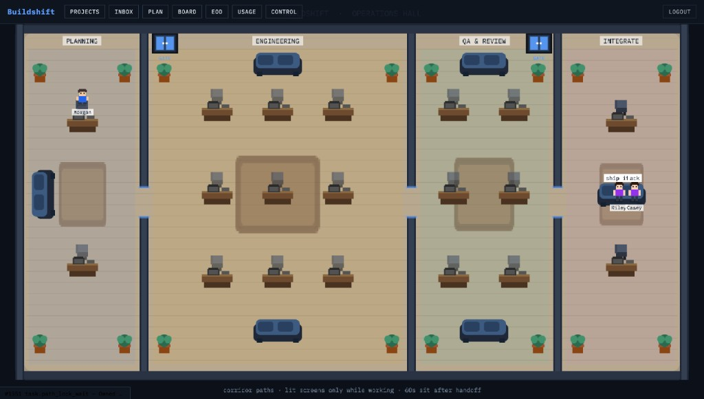

# Buildshift

**An open-source AI software house.**

Upload a product requirements document (PRD). Buildshift plans work in time-boxed sprints, runs isolated agent workers through a multi-role pipeline (tests → implement → review → integrate), and lands verified changes onto your proving repository — while you steer budgets, unblock humans-only decisions, and watch the floor.

You approve plans and handle secrets, billing, and publishing. Agents never touch `main` without your merge queue.



License: [Apache-2.0](LICENSE)

---

## Why Buildshift

Most “AI coding” tools are chat sessions. Buildshift is an **orchestration layer**:

- **Plan in waves** — one PRD becomes a project; sprints pull only as much work as you size (hours ceiling), without padding short work.
- **Verify before trust** — independent test-authoring, cross-stage review, deterministic checks, then integrate.
- **Cost and safety first** — per-task and daily budgets, kill switch, sandboxed workers, control plane in Postgres (not day-to-day `.env` edits).
- **Human in the loop** — HITL inbox for keys, accounts, ambiguous product calls, and irreversible actions.
- **Operate visually** — office floor plus HUD for projects, inbox, plan, board, EOD, usage, and control.

Design intent: [`docs/AI-Software-House-Solution.md`](docs/AI-Software-House-Solution.md)

---

## Features

| Area | What you get |
|------|----------------|
| **Projects** | Create a project, upload / replace / reindex a full PRD; modules are sliced from `##` headings |
| **Sprints** | Size a sprint by hours (1–40); propose epics/tasks from remaining backlog; kick off when ready |
| **Pause / resume** | Graceful pause — agents finish the current stage and leave pause notes; resume continues cleanly |
| **Multi-role pipeline** | Test author → implementer → reviewer → integrate / land on proving base |
| **Office floor** | Live Phaser hall: desks, corridors, hire gates, desk-to-desk task handoffs |
| **HITL inbox** | Nested by project → sprint → messages; reply to unblock |
| **Board** | Project-scoped sprint → epic → task hierarchy with status and spend |
| **EOD** | Day digest: counts, sessions, agents, hierarchy, risks |
| **Usage** | Filters by day / project / sprint; cost, tokens (when reported), model breakdown |
| **Control plane** | Models, budgets, harness, parallelism, kill switch, proving repo — live without redeploy |
| **Mock harness** | Exercise the full loop with **zero LLM spend** using in-repo fixtures |

---

## Requirements

- Docker Engine + Compose v2
- Git
- Make
- Ports (defaults): orchestrator `127.0.0.1:8080`, office `127.0.0.1:3000`

---

## Quick start

```bash
git clone <this-repo> buildshift && cd buildshift
cp .env.example .env
make up
```

| URL | Purpose |
|-----|---------|
| http://127.0.0.1:3000 | Office UI (login with `OPERATOR_TOKEN` from `.env` if set) |
| http://127.0.0.1:8080 | Orchestrator API |

Defaults use `HARNESS=mock` so you can explore without API keys.

```bash
make smoke              # one mock task end-to-end
make smoke-plan         # PRD → plan → multi-role merge
make smoke-merge-queue  # larger proving run (12 tasks on base)
make smoke-office       # settings, SSE, HITL, office health
make smoke-hud          # projects, sprints, usage APIs
make down               # stop (keep data)
```

---

## Day-to-day usage

### 1. Create a project and upload a PRD

In the office **Projects** tab (or via API):

1. Create a project (this is the product you are building).
2. Upload or paste a markdown PRD (`##` sections become modules).
3. Reindex when the PRD changes.

### 2. Plan and kick off a sprint

In **Plan**:

1. Select the project.
2. Choose sprint size in **hours** (1–40) — a ceiling, not a pad target.
3. **Propose sprint** — builds epics/tasks from remaining work.
4. Review the hierarchy.
5. **Kick off sprint** — tasks become ready; workers start claiming them.

Use **Pause** / **Resume** when you need to stop new work without aborting mid-stage.

### 3. Steer and unblock

- **Inbox** — answer HITL items (nested by project and sprint).
- **Board** — inspect sprint / epic / task standing.
- **EOD** — pick a date (and optional project) for the day’s digest.
- **Usage** — spend and model mix over a range.
- **Control** — budgets, models, harness, kill switch, proving repo.

### 4. Where code lands

Workers push branches and the merge queue lands onto your **proving** repository (local bare repo by default, or a real remote when `PROVING_REPO_URL` / `GITHUB_TOKEN` are set). `merged` means the change is on the proving base tip.

---

## Configuration

| Lives in `.env` | Lives in Control (office / API) |
|-----------------|----------------------------------|
| Database, ports, `HOST_DATA_DIR` | Role → model map |
| `GITHUB_TOKEN`, LLM keys, LiteLLM | Harness (`mock` / `claude`) |
| `OPERATOR_TOKEN` | Budgets, max parallel, max attempts |
| | Kill switch, proving repo/branch |

Seed once from `.env` + [`apps/orchestrator/config/router.yaml`](apps/orchestrator/config/router.yaml); then prefer the **Control** panel or:

```bash
docker compose exec orchestrator buildshift control settings get
docker compose exec orchestrator buildshift control settings set '{"limits":{"daily_budget_usd":80}}'
```

Full operator notes: [`docs/RUNBOOK.md`](docs/RUNBOOK.md)

---

## How it fits together

```
You (office UI / CLI / API)
        │
        ▼
  Dashboard (office + HUD)
        │
        ▼
  Orchestrator (tasks, sprints, events, control plane)
        │
   ├── LiteLLM  → model providers
   └── Workers  → one container per task → proving git remote
```

More detail: [`docs/ARCHITECTURE.md`](docs/ARCHITECTURE.md)

---

## Documentation

| Doc | Contents |
|-----|----------|
| [`docs/RUNBOOK.md`](docs/RUNBOOK.md) | Bring-up, VPS, wipe, everyday commands |
| [`docs/ARCHITECTURE.md`](docs/ARCHITECTURE.md) | System boundaries |
| [`docs/AI-Software-House-Solution.md`](docs/AI-Software-House-Solution.md) | Product design |
| [`SECURITY.md`](SECURITY.md) | Reporting and hardening |
| [`CONTRIBUTING.md`](CONTRIBUTING.md) | How to contribute |

---

## Contributing

PRs welcome. Please read [`CONTRIBUTING.md`](CONTRIBUTING.md) and the [Code of Conduct](CODE_OF_CONDUCT.md).

---

## License

Copyright contributors. Licensed under the [Apache License 2.0](LICENSE).
